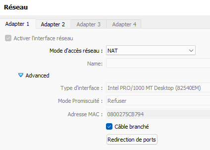
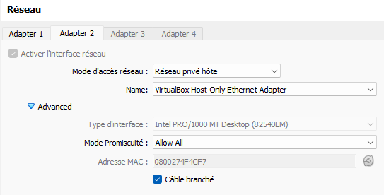

# network-anomaly-detection-system

Ce projet met en œuvre une infrastructure de sécurité et de surveillance de réseau conteneurisée avec **Docker Compose**. Elle combine un moteur de détection d'intrusions (**Suricata**), un collecteur et centralisateur de logs (**syslog-ng**) et une pile d'analyse et de visualisation (**Elasticsearch & Kibana**), afin de surveiller un serveur web applicatif, de détecter cinq types d'intrusions et d'en alerter l'administrateur.

**Sommaire**

1. [Architecture générale](#1-architecture-générale)
2. [Structure du dépôt](#2-structure-du-dépôt)
3. [Installation pas à pas](#3-guide-de-déploiement-rapide)
4. [Scénarios d'attaques et détections IDS](#4-scénarios-dattaques--détections-ids)
5. [Guide d'utilisation](#5-guide-dutilisation)
6. [Visualisation Kibana et tableau de bord](#6-visualisation-kibana-et-tableau-de-bord)
7. [Alertes et notifications](#7-alertes-et-notifications)
8. [Analyse et conclusion](#8-analyse-et-conclusion)
9. [Membres du projet et répartition des rôles](#9-membres-du-projet-et-répartition-des-rôles)

---

## 1. Architecture Générale

Le réseau s'appuie sur une interface **Host-Only** (`192.168.56.0/24`) isolée, qui simule un environnement de production : la machine hôte joue le rôle de l'attaquant (`192.168.56.1`), la VM Linux héberge la cible et toute la chaîne de supervision (`192.168.56.101`).

Nous proposons le scéma d'architecture pour illustrer les flux de données et la corrélation entre les différents composants :


### Flux de données et corrélation :

- **Suricata (IDS)** : écoute passivement le trafic réseau de l'interface Host-Only et génère des alertes JSON structurées dans `./logs/eve.json`.
- **Serveur web Apache** : enregistre chaque requête reçue et le code de réponse HTTP dans `./logs/apache/access.log`.
- **syslog-ng** : lit ces deux fichiers et transmet les logs à Elasticsearch, dans deux index distincts.
- **Elasticsearch et Kibana** : indexent les événements et fournissent un tableau de bord SOC pour l'analyse des menaces, ainsi que les règles d'alerte.

### Justification des choix

| Composant | Rôle | Pourquoi |
| :--- | :--- | :--- |
| Suricata | IDS | Règles compatibles avec la syntaxe Snort, sortie JSON native directement exploitable par Elasticsearch |
| Apache | Cible | Cible web simple, dont les logs d'accès confirment ce que Suricata détecte (code et taille de la réponse) |
| syslog-ng | Collecteur | Llit des fichiers, parse les logs texte et envoie en HTTP vers Elasticsearch |
| Elasticsearch | Stockage | Recherche rapide dans les logs, un index par type de log |
| Kibana | Visualisation et alertes | Dashboard, recherche et règles d'alerte au même endroit |
| Docker Compose | Orchestration | Déploiement reproductible en une commande |

## 2. Structure du dépôt

```text
.
├── README.md                   # Guide d'accueil et déploiement rapide
├── docker-compose.yml          # Orchestration unifiée des conteneurs
├── .env.exemple                # Variables d'environnement pour la configuration
├── configs/                    # Fichiers de configuration des services
│   ├── suricata/               # Configuration et règles IDS local.rules
│   ├── syslog-ng/              # Fichiers de pipelines de collecte
│   └── kibana/                 # Dashboard exporté de Kibana
├── html/                       # Code applicatif cible
├── ressources/                 # Scripts d'automatisation des attaques
│   └── run_all_attacks.sh      # Script d'exécution des 5 scénarios
├── docs/                       # Documentation détaillée du projet
│   ├── scenarios.md            # Fiches techniques des 5 attaques et règles IDS
│   └── visualisations.md       # Spécifications du Dashboard Kibana
└── .gitignore                  # Exclusion des logs et données de stockage
```

## 3. Guide de déploiement rapide

### Pré-requis
- Docker et Docker Compose installés sur l'hôte.
- Accès à Internet pour télécharger les images officielles.
- Interface réseau Host-Only configurée (192.168.56.0/24).

### Configurer une VM Linux :

1. Ouvrir Oracl VirtualBox et créer une nouvelle machine virtuelle.
2. Importer l'image Ubuntu Server 26.04.1 (64 bits) et allouer au moins 4 à 8 Go de RAM.
3. Configurer une première interface réseau en mode "NAT" pour l'accès à Internet et une seconde interface en mode "Host-Only" pour la communication avec les conteneurs Docker.




4. Installer Docker et Docker Compose sur la VM Ubuntu.
```bash
sudo apt update
sudo apt install docker.io docker-compose -y
sudo systemctl enable docker
sudo systemctl start docker
```
5. Augmenter la mémore virtuelle maximale pour ElastiSearch
```bash
sudo sysctl -w vm.max_map_count=262144
echo "vm.max_map_count=262144" | sudo tee -a /etc/sysctl.conf
```
6. Relever le nom de l'interface Host-Only (par exemple `enp0s8`) et son adresse :
```bash
ip -br a
```

### Lancement de l'infrastructure
<i>Tous les outils sont packagés dans des conteneurs Docker pour simplifier le déploiement et l'isolation. Il n'est donc pas nécessaire d'installer manuellement chaque composant sur l'hôte.</i>

1. Cloner le dépôt, configurer les variables d'environnement et lancer les conteneurs :

```bash
git clone https://github.com/GSavatte/network-anomaly-detection-system.git
cd network-anomaly-detection-system
cp .env.exemple .env
nano .env  # Modifier les variables si nécessaire
```

Variables du fichier `.env` :

| Variable | Rôle |
| :--- | :--- |
| `ELASTIC_PASSWORD` | Mot de passe de l'utilisateur `elastic` (connexion à Kibana, utilisé par syslog-ng) |
| `KIBANA_PASSWORD` | Mot de passe de l'utilisateur interne `kibana_system` (utilisé par Kibana) |
| `SURICATA_INTERFACE` | Interface écoutée par Suricata (celle relevée précédement à l'étape 6, ex. `enp0s8`) |
| `DISCORD_RELY_PASSWORD` | Mot de passe qui sera utilisé par Le webhook pour accéder aux logs dans Elastic |
| `DISCORD_WEBHOOK_URL` | URL du webhook discord vers où envoyer les messages d'alerte |

```bash
docker-compose up -d
```

2. Vérifier que tous les conteneurs sont opérationnels :

```bash
docker-compose ps
```

Le premier démarrage télécharge les images et dure quelques minutes. Elasticsearch doit passer en `healthy`, puis Kibana démarre (dépendement de la machine mais entre 1 et 3 minutes). Les services `setup` (définition du mot de passe `kibana_system`) et `kibana-import` (import du dashboard) sont éphémères : ils doivent apparaître en `Exited (0)`.

3. Connexion à Kibana :

Dans un navigateur se rendre à l'adresse de la machine hôte sur le port 5601 (http://localhost:5601 par exemple). Pour se connecter, saisir l'identifiant "elastic" et le mot de passe défini dans le fichier .env par ELASTIC_PASSWORD.

4. Préparation des alertes et du webhook discord

  a. Instanciation de l'index des messages

  Dans l'application web kibana, se rendre dans le menu déroulant latéral et chercher "Dev Tools" dans le sous menu "Management". Dans le champs gauche de la console de la page Dev Tools, coller le contenu du fichier    "index-setup.txt". Executer chacune des requêtes PUT (déplacer le curseur dans une requête et cliquer sur le bouton ⏯️).

  b. Importation des alertes

  Dans le menu déroulant latéral, cliquer sur le sous menu "Management", puis dans le sous menu latéral secondaire, se rendre à "Saved Object". Importer le fichier "kibana-configuration.ndjson" grâce au bouton prévu à   cet effet (en haut à droite).

Pour verifier que les importations ont réussies, verifier l'existance de l'index "kibana-alerts" dans "Index Management". Pour les alertes, constater la présence de "discord-alert" dans "Connectors" et des 5 alertes dans "Rules".

---

## 4. Scénarios d'Attaques & Détections IDS

5 scénarios d'attaque distincts ont été implémentés et validés avec des niveaux de sévérité gradués :

| SID | Nom du scénario | Vecteur / Méthode | Sévérité |
| :--- | :--- | :--- | :--- |
| **1000001** | Test PHP Exploit | `GET /index.php?exploit=1` | 3 (Basse) |
| **1000002** | Path Traversal | `GET /index.php?file=../../../../etc/passwd` | 2 (Moyenne) |
| **1000003** | Remote Command Execution | `GET /index.php?cmd=whoami` | 1 (Haute) |
| **1000004** | High Rate Requests | Rafale de 50 requêtes HTTP consécutives | 1 (Haute) |
| **1000005** | HTTP Password Brute Force | `POST /login.php` avec plusieurs tentatives | 2 (Moyenne) |

👉 **[Consulter la documentation détaillée des scénarios (docs/scenarios.md)](docs/scenarios.md)** pour retrouver les justifications techniques, le code complet des règles Suricata, les extraits de logs et les recommandations de remédiation pour l'administrateur.

---

## 5. Guide d'utilisation

### 5.1 Lancer les scénarios

Le script `ressources/simulate_attacks.sh` rejoue les 5 scénarios avec `curl`. Il doit être lancé **depuis une machine du réseau Host-Only**, et non depuis la VM elle-même : un trafic sur la machine locale passerait par la boucle locale et Suricata ne le verrait pas.

```bash
./ressources/simulate_attacks.sh                        # tous les scénarios, cible 192.168.56.101
./ressources/simulate_attacks.sh 192.168.56.101 1 3     # cible explicite, scénarios 1 et 3 seulement
PAUSE=60 ./ressources/simulate_attacks.sh               # 60 s entre scénarios
```

Par défaut, une pause de 6 secondes sépare les scénarios, pour que les fenêtres de détection de 5 secondes des scénarios 4 et 5 ne se chevauchent pas.

### 5.2 Vérifier la détection

1. **Dans Kibana** : ouvrir le dashboard `overview`. Les 5 signatures apparaissent dans le graphique d'évolution et dans le registre des alertes.
2. **Notification** : un message d'alerte arrive sur le canal configuré (section 7) dans la minute qui suit.

---

## 6. Visualisation Kibana et tableau de bord

Le dashboard est versionné dans `configs/kibana/dashboard.ndjson`. La procédure d'import et le dépannage sont décrits dans la documentation dédiée.

👉 **[Spécifications et procédure d'importation du dashboard (docs/visualisation.md)](docs/visualisations.md)**

---

## 7. Alertes et notifications

Les alertes sont déclanchées par des "rules" Kibana, qui lors de la détection de logs contenant les signatures d'alerte ajoute un log à l'index "kibana-alerts".
Un script python sert de relai entre elastic et discord. Ce script est encapsulé dans le conteneur "discord-relay" et se connecte à elastic en http pour y récupérer les alertes stockées dans l'index "kibana-alertes". Une fois récupérés, ces alertes sont retransmises par message avec un webhook discord.

Cette fonctionnalités est partiellement fonctionnelle, tous les types d'alertes ne sont pas remontés. Le disfonctoinnement vient très certainement des rules, les instances d'alertes n'arrivant pas toutes dans l'index Kibana-alertes.

Cette fonctionnalité aurais pu être plus efficace en utilisant l'action webhook mise à disposition par Kibana, ce qui aurait pu nous faire gagner beacoupe de temps. Malheureusement cette option est verrouillée derrière une licence payante.


---

## 8. Analyse et conclusion

### 8.1 Bilan

L'infrastructure répond au cahier des charges : les logs de sécurité sont collectés par syslog-ng depuis Suricata et apache, stockés dans Elasticsearch, visualisés dans Kibana, et les cinq scénarios d'intrusion sont détectés puis notifiés à l'administrateur. L'ensemble se déploie en une commande et se rejoue de manière reproductible.

Au-delà des exigences minimales, le projet fournit un dashboard personnalisé importé automatiquement au déploiement, un schéma d'architecture intégré à la documentation et des notifications automatisées.

### 8.2 Limites

**Limites de la détection**

- **Détection par signatures, pas par anomalies.** Malgré le titre de ce dépôt (choisi avant de commencer le projet), les règles recherchent des motifs connus (`exploit=1`, `../`, `cmd=`). Une attaque qui ne correspond à aucun motif n'est pas vue.
- **Règles volontairement simples, avec des faux positifs possibles.** Par exemple, l'expression régulière du scénario 3 (`id|whoami|ls|...`) correspond aussi à des valeurs légitimes contenant ces lettres. Les seuils des scénarios 4 et 5 (20 requêtes en 5 secondes, 10 POST en 5 secondes) sont arbitraires.
- **Pas de blocage.** Suricata est en mode IDS passif : les alertes affichent `action: allowed` et la requête malveillante aboutit. Le système détecte, il ne protège pas.

**Limites de l'infrastructure**

- **Sécurité de la stack allégée.** Elasticsearch et Kibana communiquent en HTTP sans TLS, et syslog-ng s'authentifie avec le compte super-administrateur `elastic` au lieu d'un utilisateur dédié aux droits limités.
- **Pas de haute disponibilité ni de redondance.** Un seul nœud Elasticsearch, aucun réplica : sur une VM au disque limité, l'espace peut se remplir. Les données sont perdues à chaque `down -v`.
- **Corrélation manuelle des deux sources.** Les logs Suricata et Apache n'ont pas d'identifiant commun : le rapprochement se fait à la main, par IP et par horodatage. Les noms de champs diffèrent aussi d'un index à l'autre (`timestamp` et `@timestamp`, `src_ip` et `apache.clientip`).
- **Mappings implicites.** Les adresses IP sont stockées comme du texte, ce qui impose l'usage des sous-champs `.keyword` et empêche les requêtes de type "plage d'adresses".

### 8.3 Difficultés rencontrées

- **Bruit dans les logs** : Suricata voyait le trafic de Kibana et l'indexait, ce qui gonflait l'index. La journalisation a été limitée aux alertes.
- **Délais de démarrage** : Kibana met plusieurs minutes à être disponible, ce qui donnait l'impression d'un échec de déploiement.

### 8.4 Améliorations possibles

- **Passer en IPS** : placer Suricata en ligne (NFQUEUE ou AF_PACKET) avec des règles `drop`, ou coupler les alertes à fail2ban pour bloquer automatiquement les sources.
- **Enrichir la détection** : charger un jeu de règles communautaire et ajouter une détection d'anomalies statistique par rapport à une base de comportement "normal".
- **Normaliser les logs** : adopter un schéma commun pour que `source.ip`, `url.original` ou `http.response.status_code` portent le même nom dans les deux index, et définir des *index templates* explicites (champs de type `ip`, `keyword`, `date`).
- **Renforcer la stack en elle-même** : TLS entre les composants, utilisateur dédié à syslog-ng limité à l'écriture dans `suricata-*` et `apache-*`, gestion des secrets plus robuste que le fichier `.env`.
- **Acquérir une licence Elastic** : Cela permettrait de profiter de plus de fonctionnalités, et de mettre en place un système d'alertes plus poussés voire intelligent.
- **Gérer le cycle de vie des données** : politique de redondance, sauvegardes.
- **Enrichir la visualisation** : géolocalisation des IP source (GeoIP), liens directs du dashboard vers le détail d'une alerte.
- **Compléter la collecte** : ajouter Wazuh pour superviser aussi les hôtes, pas seulement le réseau.

### 8.5 Perspectives et veille technologique

- **Passer du SIEM au XDR** : les solutions actuelles corrèlent réseau, hôtes et identités pour détecter des comportements anormaux plutôt que des signatures. Elastic propose notamment des jobs d'anomaly detection (soumis à licence), à étudier pour une utilisation réelle de ce projet.
- **Réponse automatisée (SOAR)** : des outils permettent d'enchaîner détection, enrichissement et blocage sans intervention humaine, ce qui accélère le temps de réponse aux incidents.

---

## 9. Membres du projet et répartition des rôles

* **Gabriel Savatte** : déploiement de l'infrastructure web/IDS, écriture des règles Suricata, configuration du centralisateur de logs (`syslog-ng`), création des scripts d'attaques, création d'un dashboard personnalisé et rédaction de la documentation projet.
* **Natan Marchais** : , intégration et déploiement de la stack ELK (`Elasticsearch` / `Kibana`), mise en place d'alertes et rédaction de la documentation projet.
