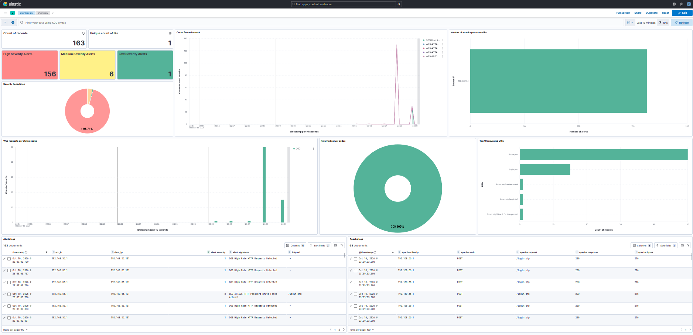
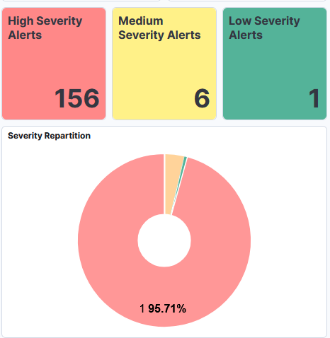
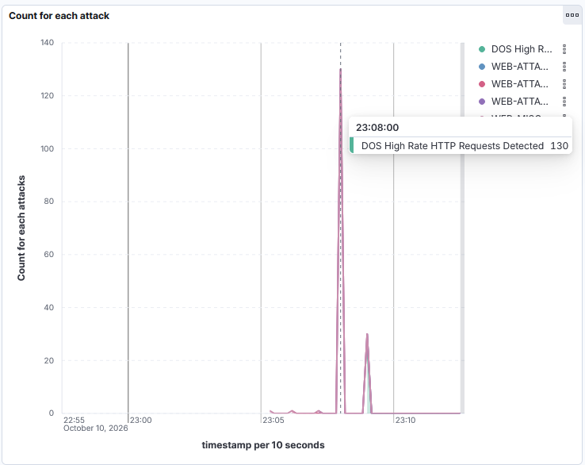
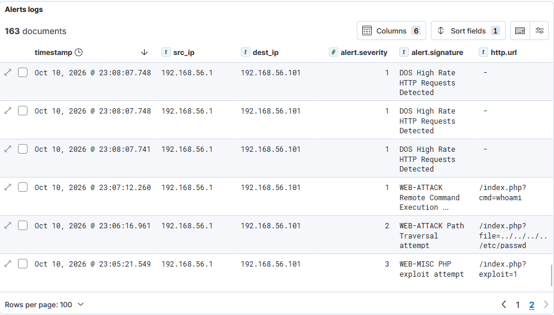
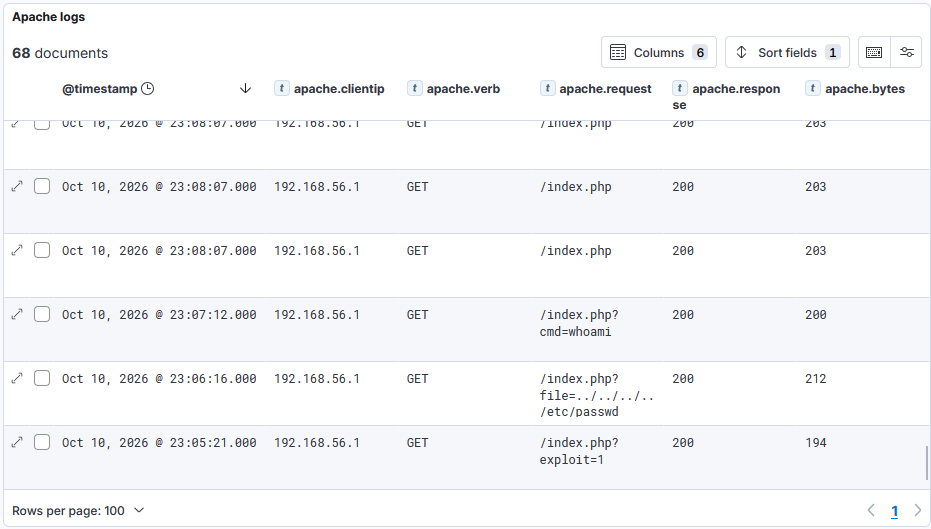

# Spécifications et Conception du Dashboard Kibana

Ce document détaille l'import, la conception, l'architecture des données et la structure des visualisations du tableau de bord Kibana destiné au suivi des événements de sécurité en temps réel.

---

## 1. Dashboard

Le dashboard est versionné dans le dépôt ([Récupérer le fichier](../ressources/dashboard.ndjson)). Il n'est pas nécessaire de le reconstruire à la main : il est possible d'importer ce fichier dans Kibana.

### 1.2 Import du Dashboard dans Kibana

1. Dans le menu burger à gauche dans Kibana : *Stack Management*, *Saved Objects*, *Import*.
2. Sélectionner [le fichier ndjson](../ressources/dashboard.ndjson).
3. Laisser l'option d'écrasement des conflits activée, puis *Import*.
4. Ouvrir *Dashboard*, puis `overview`.

### 1.3 Dépannage
Liste non exhaustive des problèmes rencontrés lors de l'import ou de l'utilisation du dashboard, avec les causes probables et les actions correctives.

| Symptôme | Cause probable | Action |
| :--- | :--- | :--- |
| Erreur `401` | `ELASTIC_PASSWORD` absent ou différent de celui du premier lancement | Vérifier le `.env` |
| `Kibana est innaccessible` | Kibana n'a pas démarré | Attendre 2 minutes que Kibana soit opérationnel. Vérifier les logs `docker compose logs kibana` |
| Erreur de champ sur un panneau | Les champs `.keyword` n'existent qu'après l'arrivée des premiers documents | *Data Views*, sélectionner la data view, *Refresh field list* |

---

## 2. Modèle de données et indexation

Le dashboard s'appuie sur deux index alimentés par `syslog-ng` :

- `suricata-eve` : alertes de l'IDS Suricata, issues du flux JSON `eve.json` (le JSON est envoyé tel quel à Elasticsearch).
- `apache-access` : logs d'accès du serveur web cible, parsés en champs par `apache-accesslog-parser` puis envoyés en JSON.

Une data view est associée à chaque index :

| Data view | Pattern | Champ de temps |
| :--- | :--- | :--- |
| `suricata-eve` | `suricata-eve*` | `timestamp` |
| `apache-access` | `apache-access*` | `@timestamp` |

Le champ de temps diffère d'un index à l'autre : `timestamp` est le champ écrit par Suricata, alors que `@timestamp` est ajouté explicitement dans le template `syslog-ng` des logs Apache.

### 2.1 Champs clés de `suricata-eve`

Les champs texte sont créés par Elasticsearch avec un sous-champ `.keyword`, à utiliser pour les regroupements et les filtres exacts.

| Champ Elasticsearch | Type de donnée | Usage dans les visualisations |
| :--- | :--- | :--- |
| `timestamp` | Date | Filtrage temporel, histogrammes d'évolution |
| `src_ip` / `src_ip.keyword` | Texte / Keyword | Addresses IP des attaquants |
| `dest_ip` / `dest_ip.keyword` | Texte / Keyword | Identification des cibles internes |
| `alert.signature.keyword` | Keyword | Agrégation par type d'attaque (nom des règles) |
| `alert.signature_id` | Nombre | Identifiant de la règle (SID 1000001 à 1000005) |
| `alert.category.keyword` | Keyword | Classification Suricata |
| `alert.severity` | Nombre | Répartition des priorités (1 : haute, 2 : moyenne, 3 : basse) |
| `http.url.keyword` | Keyword | Inspection des URL et vecteurs d'attaque |
| `http.http_user_agent.keyword` | Keyword | Détection de scanners |

### 2.2 Champs clés de `apache-access`

| Champ Elasticsearch | Type de donnée | Usage dans les visualisations |
| :--- | :--- | :--- |
| `@timestamp` | Date | Histogramme des requêtes |
| `apache.clientip` | Texte / Keyword | IP du client qui envoie la requête |
| `apache.verb` | Texte / Keyword | Méthode HTTP (GET, POST) |
| `apache.request` | Texte / Keyword | URL demandée, paramètres compris (vecteurs d'attaque) |
| `apache.response` | Texte / Keyword | Code de réponse HTTP |
| `apache.bytes` | Texte / Keyword | Taille de la réponse (fuite de données éventuelle) |

Les valeurs étant stockées comme du texte, les regroupements utilisent les variantes `.keyword` (par exemple `apache.response.keyword`) et aucune somme ni moyenne n'est possible sur `apache.bytes`.

### 2.3 Pourquoi deux sources de logs

- **Suricata** détecte : l'alerte indique qu'une règle a correspondu (tentative d'attaque).
- **Apache** confirme : le log d'accès indique ce que le serveur a répondu (code, taille). C'est ce qui permet de savoir si une tentative a abouti, par exemple si un path traversal a renvoyé un `200` avec une réponse volumineuse.

---

## 3. Structure et disposition du dashboard

Le dashboard est organisé en 5 zones fonctionnelles. Les zones 1 à 4 exploitent l'index `suricata-eve`, la zone 5 l'index `apache-access`.

Chaque zone est un regroupement visuel de plusieurs panneaux : chaque widget ci-dessous est une visualisation (ou une recherche enregistrée) distincte.
---

## 4. Spécifications détaillées des widgets

### Zone 1 : métriques clés

**Widget 1 : Total des alertes détectées (Metric)**
* **Data view :** `suricata-eve`
* **Métrique :** `Count of records`
* **Filtre :** `event_type : "alert"`
* **Objectif :** indiquer le volume global de menaces interceptées sur la période sélectionnée.

**Widget 2 : IPs source distinctes (Metric)**
* **Métrique :** `Unique count` de `src_ip.keyword`
* **Objectif :** mesurer le nombre de sources différentes à l'origine des alertes.

**Widget 3 : Alertes de sévérité 1 (Metric)**
* **Métrique :** `Count of records`, filtre du panneau `alert.severity : 1`
* **Objectif :** isoler les alertes de priorité haute, qui demandent une réaction immédiate.

**Widget 4 : Alertes de sévérité 2 (Metric)**
* **Métrique :** `Count of records`, filtre du panneau `alert.severity : 2`
* **Objectif :** isoler les alertes de priorité moyenne, qui nécessitent une attention particulière.

**Widget 5 : Alertes de sévérité 3 (Metric)**
* **Métrique :** `Count of records`, filtre du panneau `alert.severity : 3`
* **Objectif :** isoler les alertes de priorité basse, qui doivent être surveillées mais ne nécessitent pas une réaction immédiate.

**Widget 6 : Répartition des priorités de menaces (Donut)**
* **Type de visualisation :** Donut
* **Métrique :** `Count of records`
* **Slice by :** Top values de `alert.severity`
* **Couleurs :** sévérité 1 en rouge, 2 en orange, 3 en Vert
* **Objectif :** répondre à l'exigence du sujet concernant la visualisation de la répartition des priorités.

### Zone 2 : dynamique temporelle

**Widget 7 : Évolution temporelle des attaques**
* **Type de visualisation :** Area stacked
* **Axe horizontal :** `timestamp`
* **Axe vertical :** `Count of records`
* **Break down by :** Top values de `alert.signature.keyword` (au moins 5 valeurs, pour couvrir les 5 scénarios)
* **Objectif :** identifier les pics de trafic anormaux et visualiser le déclenchement des scénarios (par exemple les pics dûs au scénario DoS).

### Zone 3 : analyse des menaces

**Widget 8 : Top 5 des IPs source attaquantes**
* **Type de visualisation :** Bar horizontal
* **Axe vertical (catégories) :** Top values de `src_ip.keyword`, 5 valeurs
* **Axe horizontal (mesure) :** `Count of records`
* **Objectif :** identifier les adresses IP d'origine à bloquer en priorité sur le pare-feu.

### Zone 4 : logs d'accès web (Apache)

**Widget 9 : Requêtes web par code de réponse**
* **Data view :** `apache-access`
* **Axe horizontal :** `@timestamp` (date histogram)
* **Axe vertical :** `Count of records`
* **Break down by :** Top values de `apache.response.keyword`
* **Objectif :** visualiser le volume de requêtes dans le temps ; Le scénario 4 (DoS) apparaît comme une barre très haute.

**Widget 10 : Top URLs demandées**
* **Axe vertical :** Top values de `apache.request.keyword`, 10 valeurs
* **Axe horizontal :** `Count of records`
* **Objectif :** faire apparaître directement les vecteurs d'attaque (`/index.php?exploit=1`, `?cmd=whoami`, `?file=../../../../etc/passwd`, `/login.php`).

**Widget 11 : Codes de réponse**
* **Slice by :** `apache.response.keyword`
* **Couleurs :** vert pour 200, orange pour 404, rouge pour 500 à 511.
* **Objectif :** visualiser la proportion de requêtes réussies, refusées ou en erreur.

### Zone 5 : registre d'audit

**Widget 12 : Registre des alertes**
* **Type :** recherche enregistrée depuis Discover (affiche les alertes elles-mêmes et non des agrégats), nommée `Registre des alertes`
* **Requête :** `event_type : "alert"`
* **Colonnes :** `timestamp`, `src_ip`, `dest_ip`, `alert.severity`, `alert.signature`, `http.url`
* **Tri :** `timestamp` décroissant
* **Objectif :** permettre aux analystes d'investiguer les métadonnées de chaque requête. La colonne `http.url` est vide pour les alertes DoS, dont la règle n'inspecte pas l'URL.

**Widget 13 : Journal d'accès Apache**
* **Type :** recherche enregistrée depuis Discover sur la data view `apache-access`.
* **Colonnes :** `apache.clientip`, `apache.verb`, `apache.request`, `apache.response`, `apache.bytes`
* **Tri :** `@timestamp` décroissant
* **Objectif :** vérifier côté serveur ce qui a été demandé et répondu, en complément de l'alerte Suricata.
---

## 5. Lecture du dashboard par scénario

| Scénario | SID | Où l'observer | Signature visuelle |
| :--- | :--- | :--- | :--- |
| 1. Exploitation de paramètre PHP | 1000001 | Registre des alertes, Top URLs | Une alerte, sévérité 3 (basse) |
| 2. Traversée de répertoire | 1000002 | Registre des alertes, Journal d'accès | Une alerte, sévérité 2 ; vérifier le code et la taille de la réponse dans le journal Apache |
| 3. Exécution de commandes à distance | 1000003 | Registre des alertes, métrique sévérité 1 | Une alerte, sévérité 1 (haute) |
| 4. Déni de service | 1000004 | Évolution temporelle, requêtes web par code | Pic massif d'alertes sur quelques secondes, grosse barre de requêtes côté Apache |
| 5. Brute force d'authentification | 1000005 | Évolution temporelle, Top URLs (`/login.php`) | Pic plus modeste, concentrée sur `/login.php` |

---

## 6. Captures d'écran et preuves de validation *(à compléter)*

* **Vue globale du dashboard Kibana :**

* **Répartition des priorités :**

* **Détection du pic DoS :**

* **Registre des alertes :**

* **Logs d'accès Apache :**

---

## 7. Limites connues

* Toutes les attaques simulées partent de la même machine (`192.168.56.1`) : le Top 5 des IPs source n'affiche donc qu'une seule barre. Lancer une partie des scénarios depuis une autre machine du réseau pour un rendu plus représentatif.
* Le dashboard est vide après un déploiement : les données ne sont pas conservées entre deux `docker compose down -v`, seule la présentation est restaurée.
* L'import écrase les objets existants : toute modification manuelle dans Kibana doit être réexportée.
* Les échelles du graphique d'évolution sont dominées par le DoS : les scénarios à une seule alerte sont à lire dans le registre des alertes.
